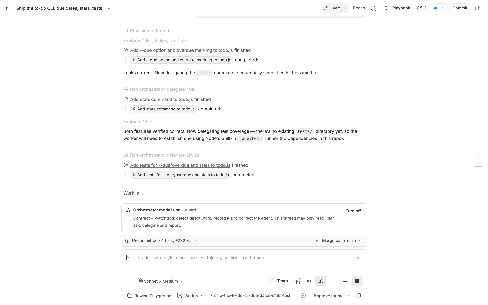
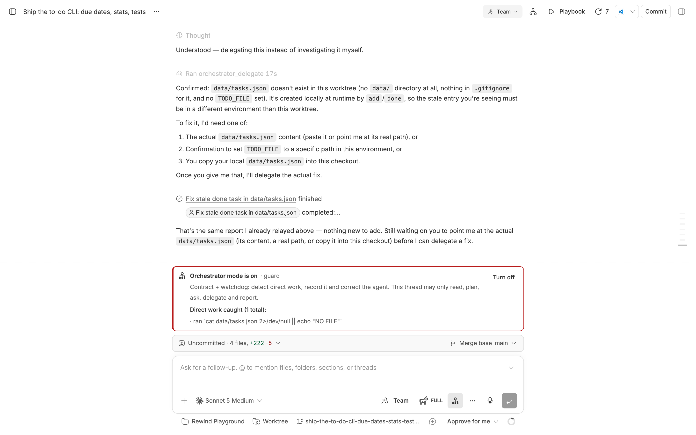
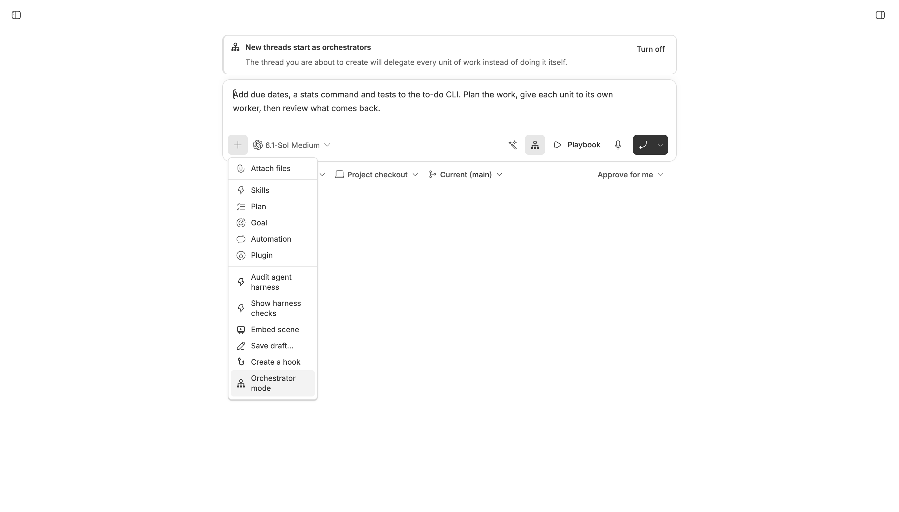
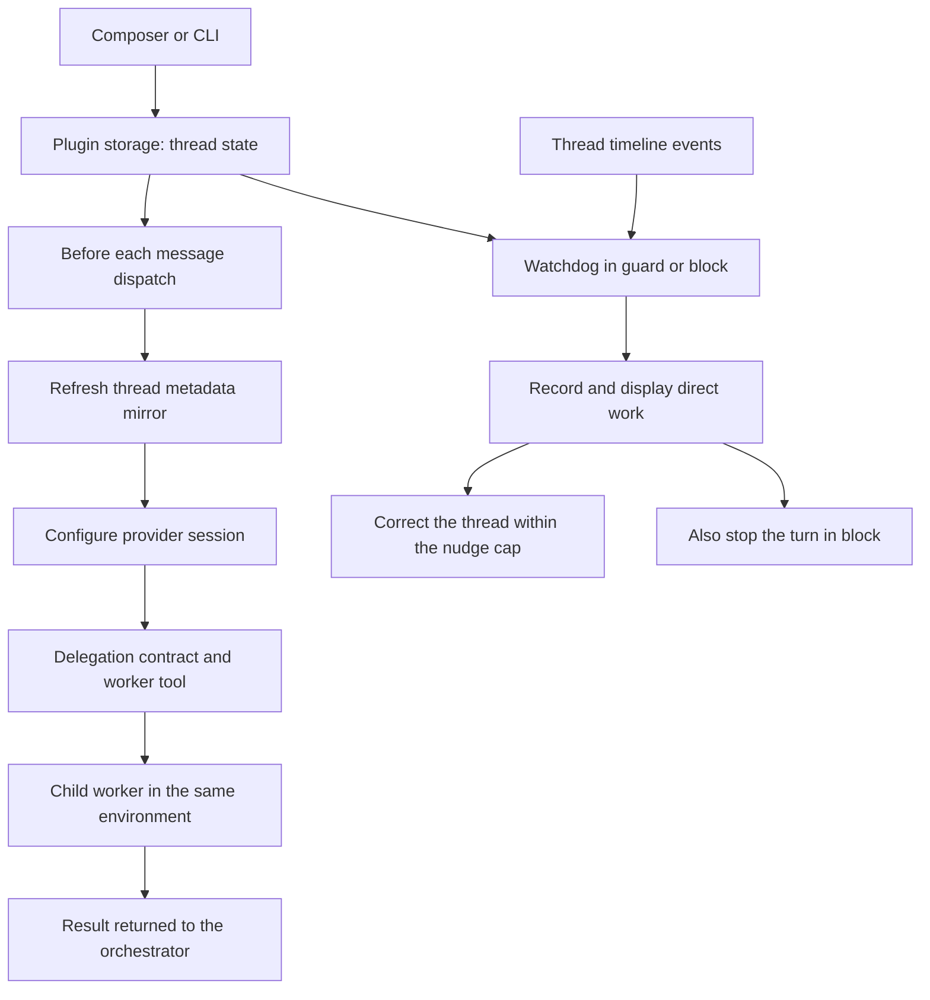

<div align="center">


# Orchestrator Mode

### Keep the plan here. Send the work to worker threads.

Make your BB thread read, plan, ask, delegate and report.<br>
Give each unit of work to a worker, with a watchdog for direct work.


[Features](#features) · [Install](#install) · [How it works](#how-it-works) · [CLI](#cli) · [Scope](#scope) · [Settings](#settings) · [Development](#development)

<br>



<table>
<tr>
<td width="50%"><br><sub>The watchdog caught the thread running a command itself, recorded it and corrected the agent.</sub></td>
<td width="50%"><br><sub>The new-thread default, and the <code>+</code> menu row that toggles either.</sub></td>
</tr>
</table>

</div>

> [!NOTE]
> These are real BB renders of a throwaway demo project (a small Node to-do
> CLI). The thread, its worker threads and the recorded violation are real. The
> Playbooks and Recap panels, which belong to other plugins, were hidden so the
> subject reads clearly. See [screenshot notes](docs/screenshots/README.md).

## The problem

You ask a thread to coordinate a task, but it starts doing the work itself.
The planning, implementation and review accumulate in one transcript, even
when parts of the task could run independently.

It can also start out delegating correctly, then drift during a long-running
conversation. It begins editing files, running commands or fixing a worker's
output itself, despite being asked to stay in the orchestrator role.

Orchestrator Mode gives that thread a delegation contract and a worker tool.
In `guard` and `block`, the watchdog checks new timeline work as the conversation
continues and can correct or stop detected direct work. You keep the plan and
final report in the parent, and can open each worker to inspect its work.

| You need | You get |
| --- | --- |
| A thread that coordinates | Instructions to read, plan, ask, delegate and report |
| Separate units of work | Worker threads in the same environment |
| A long-running thread that drifts into direct work | Ongoing timeline checks in `guard` and `block` |
| Visibility when the parent does direct work | A violation record, corrective messages and an optional stop |

## Features

<table>
<tr>
<td width="50%" valign="top">

### 🎛️ A composer switch

Toggle the current thread from the composer or its `+` menu. The status surface
shows the enforcement level, a small robot per current child in that child's
state, the child-thread count BB reports right now, the delegation ledger kept
separately, and the durable record status. Direct work the
watchdog caught sits in its own red box, with the detail and a **Clear**
action. The draft itself is never decorated.

</td>
<td width="50%" valign="top">

### 🧩 Worker threads

The `orchestrator_delegate` tool creates a child thread from a self-contained
brief and can wait for its result. Workers use the parent's environment and
appear in the sidebar unless you request a hidden worker. A unit names its
`kind` (`build`, `review` or `research`), which picks its checkout under a
`mixed` workspace and decides whether it is checked without needing a stored
preset. Optional `providerId` and `model` pins are applied before the worker
starts. Each worker's record keeps what was asked and what BB actually
resolved, side by side.
Existing sessions without that tool can use `bb orchestrator-mode delegate`.
Follow-ups with `bb thread tell <worker-id>` (alias `message`) are delegation
for recorded workers, including messages supplied through quoted stdin heredocs.

You choose their provider and model with BB's own picker in the plugin's
settings, or per delegation in the tool call, and the orchestrator has to record
a verdict for every worker it used. See [Worker
execution](#worker-execution) and [Reviewing worker
output](#reviewing-worker-output).

</td>
</tr>
<tr>
<td valign="top">

### 👁️ Three enforcement levels

Choose instructions alone, a watchdog that records and corrects, or a watchdog
that also stops the turn. The watchdog keeps checking new work as the
conversation continues. Read-only shell exploration is allowed by default.

</td>
<td valign="top">

### 🌱 A default for new threads

Use the root composer to set how new threads start. Only qualifying root
threads created while the default is on receive it; existing threads, child
workers and side chats are left alone.

</td>
</tr>
</table>

## Install

From a local checkout:

```sh
cd /path/to/bb-plugin-orchestrator-mode
npm install
bb plugin build
bb plugin install path:$PWD --yes
```

Open a thread and use **Orchestrator mode** in the composer to enable it.

**Requirements**

- bb **0.44+**, with Plugin SDK **0.5.29+**.
- Node.js and npm to install dependencies and build from source.

## Where to find it

| Where | What |
| --- | --- |
| **Thread composer** | The delegation icon toggles that thread; use **More plugin actions** if the host groups buttons. |
| **Composer `+` menu → Orchestrator mode** | The same toggle, including compact layouts. |
| **Strip above the input** | Enforcement level, live children and their robot indicators, the recorded ledger separately, durable record status, direct work in a red box with **Clear**, a worker ledger (asked vs. ran), and **Turn off**. |
| **Root new-thread composer** | Set whether qualifying new threads start as orchestrators. |
| **Settings → Installed plugins → Orchestrator Mode** | Every setting, one scope at a time: Global, or the project the selector names. |

## How it works



- **Per-thread state.** The plugin stores the switch in its own KV store and
  refreshes a metadata mirror before dispatch. Session configuration reads that
  mirror synchronously.
- **Delegation.** The worker receives your complete brief, rather than the
  parent's conversation. Independent units can be delegated in parallel.
- **Classification.** The watchdog treats file changes, image generation,
  mutating commands and mutating tool names as work. Reads, searches, plans,
  questions and delegation
  remain available; command leniency is configurable. Read-only queries may
  suppress stderr with `2>/dev/null`; output-file redirects and mutating `find`
  actions still count as work.
- **Session timing.** Running turns receive mode changes as steering messages.
  Session configuration applies when the provider session is next constructed;
  resuming can retain its original tools, so CLI delegation remains available.
  The watchdog grants grace turns during the transition.

The [design notes](docs/DESIGN.md) cover classification, retained state and
session timing in more detail.

## Worker execution

Workers run on the project's remembered provider and model unless you give them
their own. **Settings → Installed plugins → Orchestrator Mode** → the scope you
want → **Which provider and model workers use** has two choices, each a visible
pair rather than a switch:

- **Workers run on** `Inherit` (the project's remembered provider and model) or
  `Custom` (the provider, model, reasoning level and service tier you pick with
  BB's own picker).
- **Retry a failed worker** `Report` (hand the failure back to the orchestrator)
  or `Retry` (re-delegate the same brief on a second provider, model and access
  you pick, each with its own picker).
- **Per-unit model overrides** `Pinned` (default) or `Flexible`. Pinned runs
  every worker on the execution above, or on a stored kind it names as a preset:
  a delegation that passes `model`, `provider` or `reasoning` is refused, and the
  contract stops inviting one. Flexible lets the orchestrator ask for a stronger
  or cheaper model for a single unit instead.
- **Orchestrator subagents** `None` (default) or `All`. `None` counts every launch
  as work, reading agents included: BB exposes no launch-bound proof that a native
  subagent only reads, so none can be exempted. `All` permits identified subagents,
  including editing ones, within existing user and parent authority. Codex waiting,
  messaging, resuming and closing are coordination under both policies. OMP's `task`
  arguments are parsed only when its tool is identified. Older OMP/ACP rows named
  only `other` cannot establish that identity: opaque task-shaped calls remain
  unverified work even under `All`. This is a BB metadata limitation; use
  `orchestrator_delegate` for those units.
- **Worker subagents** `Blocked` (default) or `Allowed`. Blocked injects a rule
  into every worker this plugin spawns: do the unit yourself and start no
  subagents. The watchdog then watches each such worker's timeline; a launch is
  answered with a correction message, up to the scope's reminder budget. BB
  cannot stop the provider's own subagent tool before it runs, so a launch can
  land before the correction does.

### Where workers run

A scope's **Where workers run** row decides the checkout a delegation uses:

- **Shared** (default) runs every worker in the orchestrator's own checkout, so a
  diff is visible the moment a worker stops, and two units that touch the same
  files can overwrite each other.
- **Worktree** gives one unit its own git worktree and branch, created by BB from
  the project's default branch on the machine the orchestrator runs on. Nothing it
  writes lands in your checkout until you merge it, and its check unit and any
  fallback retry reuse that same worktree, so they inspect and continue the same
  working tree.
- **Mixed** leaves the choice to the orchestrator: every delegation must name
  `workspace: "shared"` or `workspace: "worktree"`, and the contract tells it to
  give a worktree to any unit that would touch files another unit is touching. A
  delegation that names neither is refused with both options spelled out, because a
  silent default would make mixed behave like shared. Naming a `kind` supplies that
  default: a build gets a worktree, a review or research unit reads the
  orchestrator's checkout. It is a property of the kind, not of a stored execution
  preset, so a scope with no presets still works.

A worktree only holds tracked files, so install what the repo needs from a
committed `.bb-env-setup.sh` (see `bb guide environments`); until that runs, a
check unit cannot execute the tests it is meant to run. The delegation result
names the branch, and `bb environment diff <id>` shows what the unit changed.

**Landing a worktree.** The orchestrator cannot merge by hand: the watchdog counts
a `git merge` as doing the work, so the contract tells it to delegate the merge as
its own unit with `workspace: "shared"`, or to name the branch for you. Either way
the merge runs in your checkout and its conflicts land in the report.
`bb environment commit` and `bb environment pull-request` also operate on the
environment directly. Deleting a worktree is core's `bb environment delete <id>`,
refused while its worker thread is live.

The retry runs once, and it covers both ways a worker fails: a spawn the
provider refuses outright, and a worker thread that lands in `error`. The
fallback inherits every field it does not name, so a retry target with no access
of its own runs with the worker's permission mode. The orchestrator is told which model the
retry used, and the contract tells it not to redo the work itself. A delegation
made with `waitForResult: false` is returned to you before it can fail, so the
retry happens for a spawn failure but not for a turn failure; the tool says so
when a fallback is configured.

The picker is BB's, not a copy: choosing a provider shows that provider's
models, and one pick resolves provider, model, reasoning level and service tier
as a single coherent value, the same value `threads.spawn` takes. That is why
this is not a plugin setting: a settings `select` cannot make its options depend
on another `select`, so a flat model list would offer models for providers you
did not choose.

A single delegation overrides it with the tool's arguments:

```json
{
  "task": "Rebuild the index and report timings",
  "kind": "build",
  "model": "claude-opus-5-5",
  "reasoning": "high",
  "permissionMode": "full"
}
```

Under a `Flexible` scope, give the hard units a stronger model and the mechanical
ones a cheaper one. The orchestrator discovers valid IDs with `bb provider list` and
`bb provider models <provider>`; both count as read-only orientation. An ID the
catalog does not offer is refused, naming the options that are available, rather
than spawning a worker whose start cannot succeed. Naming a provider that does
not serve the chosen model resolves to the model's own provider, and the
mismatch is logged.

Provider discovery runs after plugin registration, so it cannot hold up BB's
startup. Saved global and project worker choices remain available while the
catalog loads or a read fails; failed reads retry every 30 seconds. Once a full
catalog is available, effective worker, fallback and preset choices are
validated and their model/provider pairs reconciled. Discovery does not rewrite
the saved configuration. Pending queue batches also recover in the background
after registration.

`bb orchestrator-mode worker` prints the stored execution, sets it with
`--provider`, `--model`, `--reasoning`, `--tier` and `--permission`, clears it
with `--clear`, and manages the retry target with `--fallback-provider`,
`--fallback-model`, `--fallback-permission` and `--clear-fallback`. Each flag
changes one thing and leaves the rest alone: `worker --permission auto` keeps the
provider and model already stored, and `worker --fallback-permission auto` keeps
the retry target's own provider and model. Setting a worker execution or a
fallback needs both a provider and a model, because those two are what the
pickers describe.

Changing a worker's model needs the target provider to switch models at session
start. `codex` and `claude-code` do. The `acp-omp` provider answers an ACP
`session/set_model` call with *Unknown ACP ext method*, so asking for any model
other than the one it already runs fails that worker's start. Leave workers on
the project default when delegating to `acp-omp`.

## Reviewing worker output

### Queueing child messages

With orchestrator mode on, direct messages from child threads wait in BB's
persistent queue while the orchestrator is working. When its turn ends, BB
rechecks the queue and releases waiting messages as the orchestrator becomes
idle. Compatible pending updates from the same child arrive together in one
turn, with every message preserved in that child's original order. If updates
from several children are interleaved, the earliest child's pending updates
are brought together first, then the next child's. Messages to an idle orchestrator
arrive immediately. User messages and messages from unrelated threads are
not held by this policy.

**Settings → Installed plugins → Orchestrator Mode → Child messages** defaults
to **queued until turn ends**. Select **immediate** to allow child messages
into a running turn. The setting supports Global and Project scopes:

```sh
bb orchestrator-mode scope --global --child-messages queued
bb orchestrator-mode scope --project <id> --child-messages immediate
bb orchestrator-mode scope --project <id> --inherit childMessageDelivery
```

The messages stay visible in BB's queue, with their content and sender
preserved. You can use **Send now** to override the wait. Turning orchestrator
mode off or selecting immediate delivery releases the plugin's hold on the
next queue recheck.

BB's automatic child completion, failure and attention notices bypass the
plugin dispatch hook. Those notices keep BB's own delivery behavior; extending
this policy to them requires support in BB core. BB also requires queued groups
to share a sender, so combining reports from several children into one dispatch
requires a core change. This setting controls when messages are delivered;
same-child batching requires matching model, reasoning, permissions and service
tier. User messages, unrelated senders, scheduled messages and other plugins'
holds form queue boundaries. Existing groups outside the batch are preserved;
BB's grouping API can prevent automatic batching while such a group remains
queued. Results returned by a waiting
`orchestrator_delegate` call also return directly through that tool.

### Verdicts and verification

Every delegation is meant to end in a verdict, and the plugin checks for one.
The orchestrator records it with the `orchestrator_review` tool, one call per
worker whose result it used, with `accepted` or `rejected` and a line of notes.
The watchdog notices when a turn ends without one:

- The composer strip and `bb orchestrator-mode status` show how many workers are
  judged and how many are waiting.
- At `guard` and `block`, an idle orchestrator with unjudged workers is told
  once. It is asked once per set of workers, not once per turn.
- A finished turn cannot be stopped after the fact, so `block` behaves as
  `guard` for the review gate. That limit is a consequence of BB giving plugins
  no pre-tool veto, not a setting.

`orchestrator_delegate` takes `verify: true`, which spawns an **independent
check unit** on the same brief: a second worker told to inspect the repository
and report `VERDICT: pass` or `VERDICT: fail`, and told not to modify anything.
A checker that repairs the work destroys the evidence it was asked for. Its
thread is recorded as that delegation's evidence and its report comes back with
the worker's. A check unit is not itself a unit to judge, so it does not add a
second verdict to record. A build kind is checked automatically.

The check's parsed verdict is stored on the unit, read through the ordinary
Markdown a report wraps it in (`**VERDICT: fail**`, `- VERDICT: pass`,
`VERDICT: failed`). Only the checker's own text counts: the worker's report is
handed over as a block quote, and a `VERDICT:` line inside a quote or a fenced
block is that worker's claim, not the checker's. The checker's verdict must also
be the last content line of its own report and the only one it states. A report
that leaves no readable verdict, quotes one, states two, states both a pass and
a fail, or never produced one is stored as a failure with the reason, so
unreadable evidence never reads as a pass. An `accepted` verdict is refused while
that stored verdict is a failure, and a dependent unit does not start on it: a
pass in a model's report is not a verdict, and the plugin never records an
acceptance itself.

A failed check on a build unit (or a unit delegated with `verify: true`)
re-delegates it once with the check's report as the revision brief, then checks
the revision. A rejected **build** unit does the same with the reviewer's notes,
when those notes are present, and with the rejected attempt's own final report
carried into the brief so it fixes what exists instead of guessing at it; a
rejected review or research unit is reported back
for the orchestrator to re-delegate. Both are bounded by the scope's **Revisions
per unit** (`0` reports instead) and by the unit chain's own spent count, run on
the same execution and checkout, and consume a parallel slot like any worker. The
per-turn cap does not count them, because they are this plugin's own decision.
A revision that cannot start — cap reached, provider refused — is reported beside
the finished result instead of replacing it, and its chain slot is handed back.

One chain spends one budget: an automatic revision, a later rejection of any
member and a revision of a revision all claim the same counter, atomically, so a
capped chain cannot restart at 1. A revision whose own check passes resolves the
chain: the original's failed check and recorded rejection stop blocking
acceptance and dependent units, because the finding was fixed there. Claiming a
new revision clears that resolution. A call that is cancelled, or a plugin that
is disposing, starts no further worker, check or revision.

## Guardrails

Two caps stop a fan-out from running away, both read from the plugin's own
records so the refusal can name what it hit:

| Setting | Default | Effect |
| --- | --- | --- |
| `maxParallelWorkers` | `8` | Refuses a delegation while this many workers are still running. Every worker counts, including check units and fallbacks, which is why the default fits four units with a check unit each. |
| `maxDelegationsPerTurn` | `20` | Refuses a delegation once one turn has delegated this many. Check units and fallback retries do not count against it. |

`0` removes either cap. A refusal is returned to the orchestrator as a readable
error, and it is never retried on the fallback: a cap is the plugin's own
decision, not a provider that could not start.

`workerRetention` decides what happens to a worker once its result has been
read: `keep` (default) leaves every thread in the sidebar, `archive-checks`
archives check units, `archive-all` archives every worker the orchestrator has
read. Archiving is recoverable, and a worker is only archived after its output
is already in the orchestrator's hands.

Durable state is one row per thread with no shared budget, so no thread's
history can crowd out another's. The arrays are working records with per-thread
ceilings (100 violations, 50 delegations, 500 seen rows); every record a ceiling
dropped is counted, and `bb orchestrator-mode status` reports the caps, the
count actually lost and how many threads are retained. Nothing else is evicted,
and deleting a thread removes its row.

### Stall handling and execution provenance

A worker whose thread records no progress — neither `updatedAt` nor its timeline
sequence — for five minutes while `active` is assumed
stalled and receives one continue-message on the same session, up to the scope's
**Resumes for a stalled worker**. It is continued, never respawned, so a unit's
side effects cannot run twice. When the budget is spent the worker is reported
as stuck, with a note not to delegate that unit again while it may still finish.

Every delegation record keeps the execution that was **asked for** next to the
one BB **resolved**: the thread's provider and, once a provider session exists,
its session snapshot model. BB exposes no reasoning level or service tier for a
worker, so those are reported as "not reported" rather than echoed from the
request. The strip's worker ledger and `status` show both lines.

### Advisory judge

`judgeAdvisory` is off by default and is a separate explicit opt-in from the
OpenRouter key: the key alone sends nothing.

Run `bb orchestrator-mode setup-jev` to open a secure prompt in BB with a masked
field, a Show/Hide control, and explicit **Save key** and **Cancel** buttons.
The bundled [setup-jev skill](skills/setup-jev/SKILL.md) wraps the same command.
The plugin stores one key in an owner-only file beside BB's data directory. On
upgrade, an existing BB secret setting is moved to that file. The key no longer
appears in BB's plugin settings.

The setup command accepts no key argument. Enter it only in the secure prompt,
never in a shell argument, an environment variable, a log, or an agent chat.
The prompt never displays a stored key; cancelling leaves it untouched. The
settings panel reports only whether a key exists, and no copy is stored in `bb.db`.

When both are set, a check unit's
report gets a second opinion from Jev on OpenRouter's decisions endpoint. The
answer is advice appended to the delegation result and never records, blocks or
changes a verdict. The check evidence is reduced to structured metadata: its
bare verdict token (`VERDICT: pass` or `VERDICT: fail`) and allowlisted program
names (`COMMANDS: npm, git`). The OpenRouter key is sent for authentication.
Evidence arguments, paths, header values, file contents and output are not sent,
so no credential from the report —
`-u user:pass`, an `Authorization: Basic …` or `Bearer …` header, a dotted JWT,
a `--password` flag — can ride along in any spelling. A report that names no
allowlisted program is not sent at all. Prose, the verdict's own reasoning
sentence and quoted source stay local: a verdict token or program name inside a
block quote or a fenced block belongs to whatever was quoted, so it is not sent
as this check's evidence. Checkers are asked to list commands they actually ran
on unquoted lines outside fences; if they do not, Jev may still be skipped.
The request is bounded by what is left of
the delegation's own deadline and by its cancellation, though it never fails the
call: a refusal, an unreachable endpoint, an unusable answer or an expired
deadline is reported as that failure in the result, not swallowed.

## The contract

The instructions a session receives are inspectable and extensible, but not
rewritable, because the contract states exactly which acts the watchdog flags.
A free-form replacement could desync the two and make the watchdog wrong.

```sh
bb orchestrator-mode contract                              # the text this thread receives
bb orchestrator-mode contract --rules "Never edit generated/."
bb orchestrator-mode contract --clear-rules
bb orchestrator-mode contract --json                       # plus its length and the append cap
```

**Settings → Installed plugins → Orchestrator Mode** shows the same text behind
a disclosure, with its length against `configure`'s 4096-character ceiling.

**Project rules** appends its own section to the contract. The append is capped
(370 characters) because `configure` truncates the block, and the tail of it
is the part that says what to do when delegation is impossible. The cap is
measured, not guessed: the budget test builds the largest contract every preset
can produce with an append at the cap and asserts it fits.

**Contract level** picks what a session does itself, and how much it checks:

| Level | What a session does |
| --- | --- |
| `standard` (default) | Delegates the work, records a verdict on every worker, and adds a check unit only where a report cannot settle a unit. |
| `review-heavy` | Puts an independent check unit in front of every unit. The plugin starts each check itself, and each one counts against `maxParallelWorkers`, so this roughly doubles the work in flight. `verify: false` and `waitForResult: false` are refused under it. |
| `delegate-only` | Hands the reading over too: no exploratory shell commands, and finding things out is a unit of work. CLI delegation remains available. |

The check unit is adversarial, not a reread: it runs what the unit claims (the
tests, the command, the paths), pastes the raw output, and reports `VERDICT: pass`
or `VERDICT: fail`.

## Enforcement limits

- **A command has to look like one, segment by segment.** A `command` row counts
  as work when it names a program an agent plausibly runs, or carries shell
  evidence (a path, a flag, a pipe, a redirect, an assignment). A provider that
  renders a plugin tool call as a command row carries the call's title there
  instead, and a title is not a command — but the title test runs on each
  segment, because a title never contains an unquoted separator: `Review the
  changes; rm -rf build` is a command line, not a sentence. The cost is that a
  bare unknown program name with no arguments reads as a title, and that piping a
  read-only command into a script counts as work, since a script can do
  anything. A write either one performs still shows
  up as a file change.
- **Detection follows the action.** BB exposes no pre-tool-call veto. `block`
  stops a turn after detection, so a fast write can complete before the stop.
- **Grace turns are intentional.** Enabling an idle thread skips its next turn
  for watchdog judgement. Enabling mid-turn skips the active turn and the next
  one. Earlier timeline work is not judged retroactively.
- **This is a coordination aid.** The instructions and classifier are not a
  security boundary or a guarantee that every action will be caught.
- **Workers share your environment by default.** Delegation uses ordinary worker
  threads; with the default `shared` workspace they edit your checkout directly,
  and the plugin neither isolates them nor removes their provider costs. Set the
  workspace to `worktree` for a unit that needs its own copy of the repo, and see
  [Where workers run](#where-workers-run) for what that costs.

## CLI

```sh
bb orchestrator-mode status
bb orchestrator-mode on --enforcement guard
bb orchestrator-mode violations --json
bb orchestrator-mode worker --model claude-haiku-4-5-20251001
bb orchestrator-mode off
```

<details>
<summary><b>All commands</b></summary>

| Command | Does |
| --- | --- |
| `status [--thread <id>] [--json]` | Show mode, enforcement, violations, nudges and delegations. |
| `setup-jev` | Open BB's secure prompt for the advisory judge's OpenRouter key. Takes no key argument; Save stores the one secret, Cancel changes nothing, and no key is printed or returned. |
| `delegate --task <brief> [--title <title>] [--kind <kind>] [--workspace <shared\|worktree>] [--provider <id>] [--model <id>] [--verify] [--no-wait] [--timeout <seconds>] [--hidden] [--thread <id>] [--json]` | Delegate through the CLI; `--verify` runs an independent check after the worker finishes and cannot be combined with `--no-wait`. |
| `review --worker <id> --verdict accepted\|rejected [--notes <text>] [--verified-by <id>] [--json]` | Record a worker verdict from the orchestrator's own shell, when the native tool is unavailable. No `--thread`: only the calling thread can judge its workers. |
| `check --worker <id> [--json]` | Run the independent check a worker is still waiting for when the native tool is unavailable. Refuses a check that already stored a verdict. |
| `on [--thread <id>] [--enforcement instruct\|guard\|block] [--json]` | Enable the thread, with an optional enforcement override. |
| `off [--thread <id>] [--json]` | Disable the thread and clear its enforcement override. |
| `scope [--global \| --project <id>] [--enforcement <level>] [--read-commands on\|off] [--max-nudges <n>] [--max-parallel <n>] [--max-per-turn <n>] [--max-revisions <n>] [--max-stall-resumes <n>] [--judge-advisory on\|off] [--contract-preset <standard\|review-heavy\|delegate-only>] [--retention <policy>] [--worker-workspace <shared\|worktree>] [--worker-provider <id>] [--worker-model <id>] [--clear-worker] [--rules <text>] [--clear-rules] [--inherit <key>] [--inherit-all] [--json]` | With `--global`, read or write the record every project inherits (settings only; the worker execution and rules have their own commands). With `--project`, read or write that project's overrides: settings, worker execution and appended rules. Without either, list every project that has any. |
| `contract [--thread <id>] [--rules <text>] [--clear-rules] [--json]` | Print the exact instructions this thread receives, or set and clear the project rules appended to them. |
| `violations [--thread <id>] [--clear] [--json]` | List violations, or clear them and reset correction counters. |
| `default [on\|off] [--json]` | Show or set the default for new threads. |
| `worker [--provider <id>] [--model <id>] [--reasoning <level>] [--tier <default\|fast>] [--permission <mode>] [--fallback-provider <id>] [--fallback-model <id>] [--fallback-permission <mode>] [--clear-fallback] [--preset <name>] [--clear-preset <name>] [--clear] [--json]` | Show, set or clear the execution every delegated worker defaults to, the provider, model and access a failed worker is retried on, and the named execution presets. With `--preset`, the execution flags write that preset instead of the worker execution. |

`--thread` (alias `-t`) defaults to the thread running the command. In an
ordinary terminal, provide a thread ID for thread commands.

</details>

A delegation that names a `preset` gives every child it spawns that name in its
title, uppercased and colon-separated (`BUILD: Add a retry to src/retry.ts`,
`RESEARCH: find the call sites (check)`), so the sidebar says what a worker is
doing without opening the brief. A title that already names the preset is left
alone, and a delegation without one is titled exactly as before.

Three tools. `orchestrator_delegate({ task, title?, waitForResult?,
timeoutSeconds?, hidden?, workspace?, preset?, verify?, provider?, providerId?, model?,
reasoning?, permissionMode? })` hands one unit to a worker,
`orchestrator_review({ workerThreadId, verdict, notes?, verifiedBy? })` records
your verdict on the result, and `orchestrator_check({ workerThreadId })` runs the
independent check a unit is still waiting for. The watchdog expects one verdict
per worker whose result was used.

If this session lacks the `orchestrator_review` tool, run
`bb orchestrator-mode review --worker <id> --verdict accepted|rejected --notes "..."`
from the orchestrator's own shell. It records the same verdict. It takes no `--thread`,
so a worker cannot name its orchestrator and judge its own output. Without
`orchestrator_check`, `bb orchestrator-mode check --worker <id>` runs a pending
check the same way. A unit that asked for a check and has none is pending, not
passed: it cannot be accepted and no dependent unit starts on it until the check
reports. One check runs per unit at a time, and a recovery check is bounded: at
most two attempts, each charged to the turn's delegation budget, and none for a
unit that ended in error or a chain a later revision already settled.

A check claim records the checker thread as soon as BB spawns it, so an expired
claim is reconciled rather than assumed dead. A checker that is still running
keeps the unit and the call is refused with its id, a checker that settled has its
real report recorded as the unit's evidence (fail-closed when it left no verdict),
and only a run that never spawned a worker is released. A checker the ledger could
not record — the state write failed after the spawn — is therefore never duplicated
by a later recovery, and its silence is never read as a pass.
The brief is required and limited to 20,000 characters; the title is limited to
200. Waiting defaults to `true`, with a 900-second total timeout (range
10–3,600) that the worker, its check unit and any revision share.
`hidden` defaults to `false`. A timeout returns the worker's status and leaves it
running. `workspace` picks where this one unit runs: `shared` or `worktree`, overriding the
[worker workspace](#where-workers-run) setting for that call. Under a `mixed`
scope it is required, and under `shared` or `worktree` it is the way to make one
unit the exception. `preset` names a stored execution preset, applied under the call's own
arguments; asking for one that is not stored is an error that names the ones
that are, and the contract names the stored kinds so the orchestrator knows what
it may ask for. `verify` adds a [check unit](#reviewing-worker-output). The four
execution arguments are optional and fall back to a preset, then the
[worker execution](#worker-execution), then the project defaults.

Optional `provider` (alias `providerId`, 1–120 characters) and `model`
(1–200) are trimmed; blank pins are rejected. If both provider names are
supplied, they must match. Provider pins are never silently retargeted: name a
model that the pinned provider serves. The CLI equivalents are `--provider`
(aliases `--provider-id` and `--providerId`) and `--model`. Pins take effect
before the first turn and do not require disabling orchestrator mode. Failed
spawns are not retried with unpinned workers; an explicitly configured retry
target still applies.

The bundled [skill](skills/orchestrator-mode/SKILL.md) explains the mode, delegation
and CLI. Enabling an active turn sends the contract as a steering message. An
existing idle ACP/OMP session may resume with its old instructions and tool list,
even after a runtime stop; the enabled status alone does not prove the contract
was delivered. The CLI fallback remains available, but cannot make the session
follow a contract it never received. The separate
[setup-jev skill](skills/setup-jev/SKILL.md) is the manual, agent-safe route to
storing the advisory judge key: it runs `bb orchestrator-mode setup-jev` and
never handles the credential itself.

## Scope

Every setting, the worker execution, the execution presets and the appended rules
resolve in layers, highest first:

1. **The thread.** Its own on/off switch and enforcement override, as before.
2. **The project.** Whatever that project overrides under **Settings → Installed
   plugins → Orchestrator Mode**, with **Scope** set to that project.
3. **Global.** The record every project inherits, edited with **Scope** set to
   Global or `bb orchestrator-mode scope --global`.
4. **The built-in default**, when nothing names a value at all.

A project that overrides nothing inherits everything, so an install that never
touches the selector behaves exactly as it did before. The selector lists Global
plus every project; the rows below it show each field's effective value, whether
it is overridden, and the Inherit action that hands it back. `defaultForNewThreads`
stays global on purpose: it is a composer default rather than thread behaviour,
and its row appears only in Global scope. `defaultEnabledAtMs` is bookkeeping for it.

```sh
bb orchestrator-mode scope                                     # every project that overrides anything
bb orchestrator-mode scope --global --max-parallel 2           # the record every project inherits
bb orchestrator-mode scope --global --read-commands off        # ...for read-only shell commands
bb orchestrator-mode scope --project <id> --max-parallel 2     # cap fan-out for one project
bb orchestrator-mode scope --project <id> --contract-preset delegate-only --rules "Never touch generated/."
bb orchestrator-mode scope --project <id> --inherit maxNudges  # one field back to the global value
bb orchestrator-mode scope --project <id> --inherit-all        # this project inherits everything again
```

The global worker execution is `bb orchestrator-mode worker`, and the global
rules are `bb orchestrator-mode contract --rules`, so `scope --global` refuses
their flags rather than writing a second copy of the same value.

`status --thread` names the scope it resolved and which fields the project
overrides, so a surprising cap or contract can be traced to the layer that set it.

## Settings

The plugin renders this surface itself: **Settings → Installed plugins →
Orchestrator Mode → Settings**. It is not BB's settings form, because a
descriptor setting holds one value per install and these resolve per project.
The values are stored by the plugin, and change only through this section, the
CLI, and the composer toggles.

<details>
<summary><b>All settings</b></summary>

| Setting | Default | Effect |
| --- | --- | --- |
| `defaultForNewThreads` | `false` | Enable qualifying root threads created while the default is on, at a user-initiated dispatch. Global only. |
| `enforcement` | `guard` | `instruct`: contract only. `guard`: record and correct. `block`: also stop. A thread override takes precedence. |
| `allowReadCommands` | `true` | Treat recognised read-only shell commands as exploration; when off, all commands count as work. |
| `maxNudges` | `3` | Corrective messages per enablement, for direct work and for unjudged workers. It is one budget shared by both gates, whichever spends it first, and `bb orchestrator-mode status` reports the split; non-negative numbers are rounded down. `0` disables nudges. Recording and `block` stops continue after the cap. |
| `contractPreset` | `standard` | Which [contract level](#the-contract) a session receives. |
| `workerRetention` | `keep` | What happens to a worker once its result has been read: keep it, archive check units, or archive every read worker. |
| `workerWorkspace` | `shared` | Where a delegation runs: `shared`, `worktree`, or `mixed` (the orchestrator names one per unit, see [Where workers run](#where-workers-run)). |
| `orchestratorSubagents` | `none` | Allow identified subagents (`all`), or none (`none`, the default). Reading subagents count as work too, because BB cannot verify that a native one only reads. |
| `workerSubagents` | `blocked` | Inject the no-onward-delegation rule, or omit it with `allowed`; neither value grants tools or changes permission mode. |
| `maxParallelWorkers` | `8` | Refuse a delegation while this many workers are running. `0` removes the cap. |
| `maxDelegationsPerTurn` | `20` | Refuse a delegation once a turn has delegated this many. `0` removes the cap. |
| `maxRevisions` | `1` | Re-delegations one unit chain may spend after a failed check or a rejected review. `0` reports the failure instead. |
| `maxStallResumes` | `1` | Resume messages one worker may receive after five minutes with no recorded progress, shared by every waiter watching it, before it is reported as stuck. A resume continues the same session. |
| `judgeAdvisory` | `false` | Explicit opt-in for the advisory judge. A stored OpenRouter key alone sends nothing; it is the key **and** this value. |

Every row except `defaultForNewThreads` is read and written in the selected
scope, and the defaults above are the built-in record a fresh install starts
from. The worker execution and the presets are stored by the plugin too, so they
can use BB's own provider and model picker. See [Worker execution](#worker-execution).

Re-enabling an already enabled thread preserves its nudge count. Disabling it
or clearing violations resets the correction counters.

</details>

<details>
<summary><b>Turning it off</b></summary>

Use the strip's **Turn off** button or `bb orchestrator-mode off` for one thread.
Use `bb orchestrator-mode default off` to stop enabling future threads.

```sh
bb plugin disable orchestrator-mode
bb plugin enable orchestrator-mode
```

`bb plugin remove orchestrator-mode` uninstalls the plugin.

</details>

## Release notes

See the [0.1.4 release notes](docs/releases/0.1.4.md) for worker model pins,
subagent policies and contributor acknowledgements. The
[0.1.3 release notes](docs/releases/0.1.3.md) cover the composer fix. The
[0.1.2 release notes](docs/releases/0.1.2.md) cover worker controls,
watchdog fixes and upgrade guidance; the
[changelog](CHANGELOG.md) records the full version history.

## Development

```sh
npm install
npm test
npm run typecheck
bb plugin build
bb plugin install path:$PWD --yes
bb plugin dev
```

```text
server.ts   settings, storage, dispatch hook, watchdog, delegation, RPC and CLI
shared.ts   pure policy, command classification and contract text
app.tsx     composer toggle, status strip, settings section and secure setup prompt
assets/     canonical delegation icon used by BB
skills/     bundled agent skills (orchestrator-mode, setup-jev)
docs/       README logo, screenshots and design notes
```

Tests exercise the pure policy, backend behaviour through the SDK's fake plugin
host, and composer and setup surfaces through React render tests. They cover state
mirroring, default eligibility, grace turns, read-only commands, delegation,
enforcement, RPC, CLI and the secure key prompt.

`PLUGIN_OVERVIEW.md` is the store listing. Keep it in step with this README,
the bundled skill and `bb.description` in `package.json`. Keep generated `dist/`
out of Git. There are no CI workflows in this repository.

See [screenshot notes](docs/screenshots/README.md) when refreshing the captures.

## Licence

[MIT](LICENSE)
